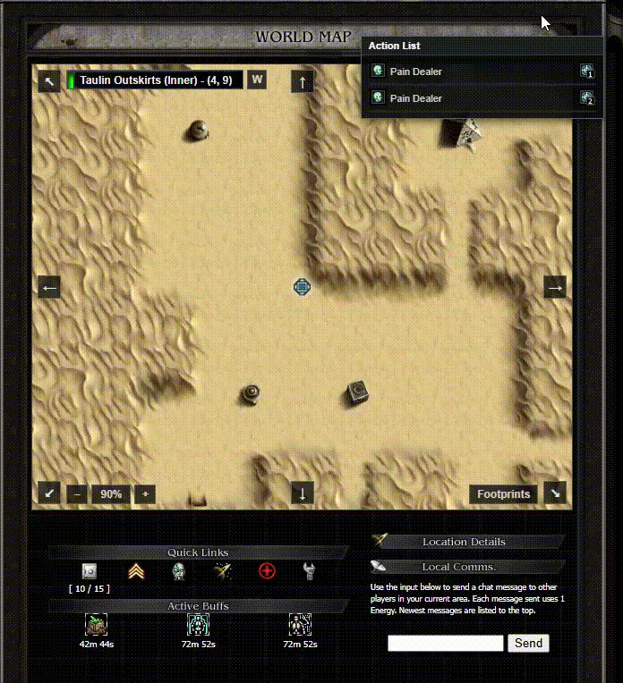
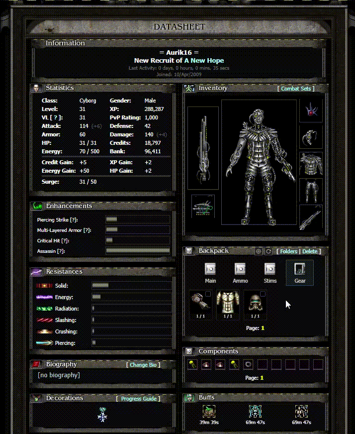

# Sigmastorm Helper

Quality of life for [Sigmastorm](https://www.sigmastorm.com/): a bigger world map you can walk on, a modern profile and backpack, better tooltips, gear comparison. A userscript, free and open source (MIT).

**Install:** open **https://cristimirt.github.io/sigmastormhelper/** and follow the three steps (you need the [Tampermonkey](https://www.tampermonkey.net/) browser extension). Nothing to update afterwards: the script updates itself.

## See it working

**Map and combat**: hover a tile to see the route, click to walk it, check a creature and fight it in place.



**Backpack and gear**: folders, moving items, using and equipping, no page reloads.



## Everything the helper changes

The helper only changes how pages look and how they are used in your own browser. It sends the same requests the game's own buttons and links send, and only when you click or press a key (plus a few read-only background reads: item data for tooltips, gear durability, the data files). The whole helper can be turned off at any time in Tampermonkey, or for one page by adding `ssh=off` to its address.

### On every page

- **Modern layout toggle** (bottom left, remembered): `Modern` uses divs and modern CSS instead of tables. The header, sidebars and footer are updated on all pages, but only some pages got the modern treatment for their contents. `Original` keeps the game's own pages. The sidebar widgets can be dragged to another place, also to the other sidebar.
- **Better tooltips**: they follow the pointer, never get stuck, load without freezing the page, and work for carried items too. Buffs and skills explain what they do, and the energy tooltip counts down to the next gain and shows when it will be full.
- **Gear comparison**: the tooltip of an item you are not wearing is shown next to the worn one, with the differences coloured.
- **Top banner**: real HP, skill power and energy numbers, and a gear durability bar.
- **Config page tab**: settings for all of the above, with export / import of everything.
- **Follows the game's changes**: the game's new request rules (token, POST forms) and broken pages are handled, its messages show their links and line breaks, pop-ups stay readable, and the upgrade stars of item tooltips load again.

### World map

- **A bigger map** you can zoom and drag, with moving, stairs and fights in place, without page reloads.
- **Click to walk** along a planned route, with fast walk, a direction pad and hotkeys; the zone bar links to the wiki and the Guide.
- **Path Finder** to find the way to any area, with the stairs marked on the map (and a "no entry" mark for areas above your level), and footprints of where you have been.
- **Transit portals**, **healing**, **quests** and the **mechanic** (repair all) work in dialogs or in place.
- **Faction Inventory**: every item of the faction in one list you can filter, sort, recall and take from.

### Action list and combat

- **Floating action list** you can drag anywhere, with number-key attacks and quick fights whose results are written into the list, and a combat log.
- **Creature kinds** (Champion, Elite, HK, Behemoth) have their own colours, bold names and tinted rows; settings choose the colours and which kinds get attack hotkeys.
- **Creature pop-up** with its stats and a combat evaluation.
- **Quick links** for the backpack, assault, buffs, medipacks and repair kits, with counts of what you have left.

### Profile, backpack and blueprints

- **Modern profile** with panels you can move and hide, and a backpack that works without reloads: folders, selecting, moving, combining, splitting, using, equipping and destroying items.
- **Combat sets** you can search, use, save and delete.
- **Blueprints**: hover to see what one makes, and manage folders and blueprints without reloads.

### Updates

The helper updates itself, and its data files (walkable tiles, skills, area numbers) are updated separately from the code.

## How it is delivered

```
Tampermonkey                       GitHub Pages (this repo, built by GitHub Actions)
┌─────────────────────┐  fetch    ┌──────────────────────────────────────────────┐
│ loader (tiny, rare  │ ───────►  │ manifest.json   current build + data hashes  │
│ updates)            │           │ resources/prod/<build>/main.min.js  (bundle) │
│                     │ import()  │ data/*.json     tiles, skills, stim buffs    │
│                     │ ───────►  └──────────────────────────────────────────────┘
└─────────────────────┘
```

- `loader/sigmastormhelper.user.js` is what players install. On every page load it fetches `manifest.json` (never cached), then imports the bundle the manifest names. A new push to `main` therefore reaches everybody on their next page load, without a Tampermonkey update. If GitHub is unreachable the loader uses the last working build.
- The static data in `data/*.json` is **not** part of the bundle. The manifest holds a hash for each file; the script downloads a file only when its hash changed and keeps it in localStorage. A data fix needs no new code.
- `site/` is the install page (it also shows whether the loader is installed).

## Development

```
npm install
npm run dev          # build (unminified) and serve dist/ on http://127.0.0.1:8765/
```

Then, in the game's tab (browser console):

```js
localStorage.setItem('SSH_dev_base', 'http://127.0.0.1:8765/')   // the installed loader now uses your local build
// localStorage.removeItem('SSH_dev_base')                       // back to the published version
```

To see a page without the helper (the game as it is, or while another copy of the helper is being tested), add `ssh=off` to its address: `https://www.sigmastorm.com/index.php?cmd=profile&ssh=off`. The installed loader (version 1.0.1 and later) then does nothing on that page.

After a change run `npm run build:dev` (the server reads the files on every request) and reload the game. `npm run check` bundles everything and validates the data files; it also runs on every pull request.

### Layout

| Path | What |
| --- | --- |
| `src/main.js` | Entry point: loads the data, then starts the helper |
| `src/core/` | Shared base: constants, state `S`, `store` (localStorage), small helpers, data loader, the token / POST handling (`net.js`), `pageParts()` (where the header, sidebars and content are), the repair of broken pages, creature kinds, image address fixes |
| `src/game/` | The world page: parsing, map, path finding, action list, combat, creature pop-up, page loading, events |
| `src/layout/` | The Modern layout: profile sections, backpack, combat sets, dialogs, themes, the banner, the page frame, the world page and the draggable sidebars |
| `src/tooltips/` | Tooltip replacement, skill / buff descriptions, energy countdown, gear comparison, blueprint preview |
| `src/pages/` | Other pages worked in place: the blueprint list (Inventing), the Faction Inventory, quests, the bank |
| `src/pathfinder/` | The Path Finder panel and its route finder |
| `src/media/` | Pictures the helper itself uses (copied to the site's `media/`): the banner's smoother orb animations, the HD page background and the content footer |
| `src/banner.js`, `src/settings.js` | Top banner numbers; the Config page tab |
| `data/` | Walkable tiles, skill descriptions, stim buffs, the Guide's area numbers (plain JSON, easy to review) |
| `loader/` | The Tampermonkey loader |
| `site/` | The install page |
| `tools/` | Build, local server, and the wiki tile mapper (development only, not published) |
| `docs/NOTES.md` | Detailed notes on how the game's pages work and how each feature was built |

### Updating the data

Edit the JSON in `data/` and push. `realms.json` maps an area's name to its number in the Guide (`guide.sigmastorm.com/index.php?cmd=realms`, 27 pages of areas): add a line when the game gets a new area. `tiles.json` maps a tile picture id to `w` (walkable) or `b` (blocked); `tools/wiki-mapper.user.js` exports it from the wiki's map pages. `skills.json` is keyed by the skill id (the number in `skills/<id>_small.gif`), `buffs-extra.json` by lower-case buff name (stims and the like).

## Contributing

Issues and pull requests are welcome. Keep changes focused, run `npm run check`, and describe what you tested in the game. The helper only talks to sigmastorm.com; please keep it that way.

## License

[MIT](LICENSE). Not affiliated with the owners of Sigmastorm.
