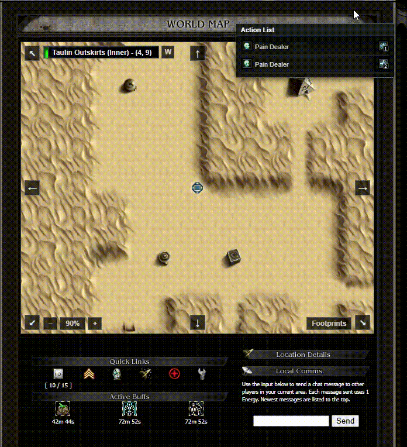
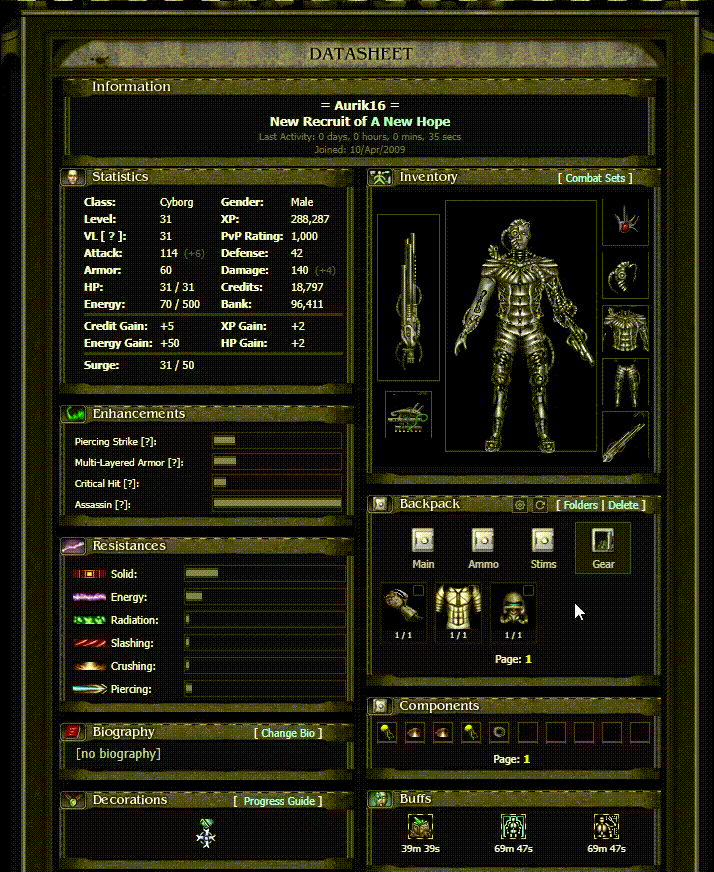

# Sigmastorm Helper

Quality of life for [Sigmastorm](https://www.sigmastorm.com/): a bigger world map you can walk on, a modern look for the game's pages, a Path Finder, better tooltips and many small conveniences. Free and open source (MIT).

**Install:** open **https://cristimirt.github.io/sigmastormhelper/** and follow the three steps (you need the [Tampermonkey](https://www.tampermonkey.net/) browser extension). It updates itself.

## See it working

**Map and combat**: hover a tile to see the route, click to walk it, check a creature and fight it in place.



**Backpack and gear**: folders, moving items, using and equipping, no page reloads.



## Features

### Everywhere

- **Modern layout**: a clean new look for the game's pages, with an `Original | Modern` switch in the bottom left corner. Sidebar widgets can be moved around.
- **Better tooltips**: they follow the pointer, load fast and show more. Skills and buffs explain what they do at your level, and the energy tooltip shows when it will be full.
- **Gear comparison**: an item you are not wearing is shown next to the worn one, with the differences coloured.
- **Top banner**: exact HP, skill power and energy, and a gear durability bar.
- **Settings** in a tab of the Config page, with export / import.

### World map

- **A bigger map** you can zoom and drag, with moving, stairs and fights without page reloads.
- **Click to walk** along a planned route, with fast walk, direction pad and hotkeys.
- **Path Finder**: the shortest way to any area, on the map, on portal pages and on world maps.
- **Stairs marked** on the map, with a "no entry" mark when the area is above your level.
- **Footprints**, **Wiki** and **Guide** buttons for the current area.
- **Transit portals**, **healing**, **quests**, **mechanic** and the **Teleport** button work in dialogs or in place.

### Combat

- **Floating action list** you can drag anywhere, with number-key attacks, quick fights and a combat log.
- **Creature kinds** (Champion, Elite, HK, Behemoth) in their own colours.
- **Creature pop-up** with its stats and a combat evaluation.
- **Quick links** for the backpack, assault, buffs, medipacks and repair kits, with counts.

### Character

- **Modern profile** with panels you can move and hide.
- **Backpack** without reloads: folders, moving, combining, splitting, using, equipping, destroying.
- **Combat sets** you can search, use, save and delete.
- **Buffs**: click an active skill to remove it, with live timers.
- **Quick Buff window**: see what is active on your targets, the cost, and cast Nano Blood from it.
- **Skills page** and **Skill Guide** in the new look.

### Faction and community

- **Faction Inventory**: every item in one list you can filter, sort, recall and take from.
- **Faction Chat** and **Faction Log** with player names and links to their pages.
- **Locate Player**, **Transmit Message**, **Slaughterfest** and the **Mailbox** in the new look.
- **Official Guide** in the new look, with pictures for shops and stairways on the area maps.

### Shops and crafting

- **Multi-buy** in shops and **multi-craft** on blueprint pages.
- **Blueprints**: hover to see what one makes, and manage folders without reloads.
- **Bank**, **Blacksmith**, **Engineering**, **Evolve** and **Item Augmentation** in the new look.

## Good to know

The helper only changes how pages look and how they are used in your own browser. It talks to sigmastorm.com only, and only does what the game's own buttons do when you click. You can turn it off any time in Tampermonkey, or for one page by adding `ssh=off` to its address.

## Development

```
npm install
npm run dev     # build and serve on http://127.0.0.1:8765/
npm run check   # build and validate the data files
```

More notes for developers are in [docs/NOTES.md](docs/NOTES.md). The list of changes is in [docs/changes.md](docs/changes.md).

## Contributing

Issues and pull requests are welcome. Keep changes focused, run `npm run check`, and describe what you tested in the game.

## License

[MIT](LICENSE). Not affiliated with the owners of Sigmastorm.
