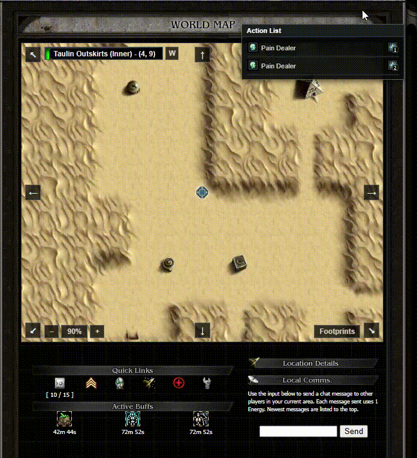
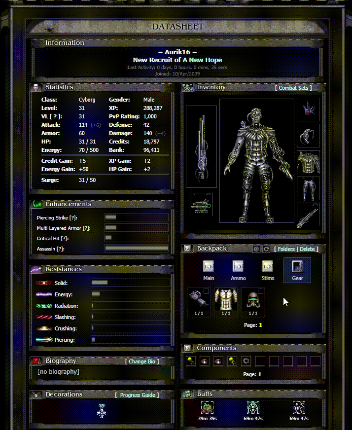

# Sigmastorm Helper

Quality of life for [Sigmastorm](https://www.sigmastorm.com/): a bigger world map you can walk on, a modern profile and backpack, better tooltips, gear comparison. A userscript, free and open source (MIT).

**Install:** open **https://cristimirt.github.io/sigmastormhelper/** and follow the three steps (you need the [Tampermonkey](https://www.tampermonkey.net/) browser extension). Nothing to update afterwards: the script updates itself.

## See it working

**Map and combat**: hover a tile to see the route, click to walk it, check a creature and fight it in place.



**Backpack and gear**: folders, moving items, using and equipping, no page reloads.



## Everything the helper changes

The helper only changes how pages look and how they are used in your own browser. It sends the same requests the game's own buttons and links send, and only when you click or press a key (plus a few read-only background reads: item data for tooltips, gear durability, the data files). The **Original** layout switch keeps the game's own profile page; the whole helper can be turned off at any time in Tampermonkey.

### On every page

- **Layout switch** (bottom left corner, remembered): `Original` keeps the game's own pages; `Modern` rebuilds the pages the helper knows (right now the profile) with modern CSS. A theme list sits next to it (only "Original Core" for now).
- **Tooltips replaced.** The game's tooltip library could leave a tooltip stuck to the mouse or stalled off-screen. The new one follows the pointer, opens towards the middle of the window, always closes when you leave the item, and looks like the original (same width, colours and text).
- **Item tooltips no longer freeze the page.** The game loaded item data with a blocking request (about 0.3 s of frozen page per item). The helper shows "Loading Stats..." at once and fills it in when the data arrives; answers are kept for a minute.
- **Buff and skill tooltips explain themselves.** Buff icons and the right-hand "Skills" panel now show what the skill does, with every "x% per point" worked out for the skill's level, plus its cost and duration. Built in: all 133 skills of the skill pages and the stim buffs (Scavenger, Micro Generator, Mind Orb; Accelerator only has what the game says about it).
- **Gear comparison.** The tooltip of an item you are not wearing is shown next to the tooltip of the worn item of the same kind (Weapon, Helmet, Weapon Add-On, ...), the one you hover on the side of the pointer. In the hovered item, every Bonus, Enhancement and Resistance is green when it beats the worn item and red when it does not, with the difference in brackets, e.g. `+16 (+5)`; numbers only the worn item has are added as `0 (-6)`. It works wherever the character display is on the page, and can be turned off on the Config page.
- **Energy tooltip.** A live countdown to the next gain, the energy right now (the hourly gains since the page was loaded are added), and a new **Full in** row with the time it will be full, in your time and in server time. The gain per hour is read from the tooltip, not fixed.
- **Top banner.** Real HP, skill power and the energy maximum written on the bars; a **gear durability bar** under the HP bar (all equipped items added up, re-read in the background when a page loads and after actions, hover for the time of the last check). Updated straight away after fights and actions.
- **Side panels.** *Game Stats* and *Kill Logs* move to the left column (option); a stray blank line after the copyright is removed.
- **Config page: "Sigmastorm Helper" tab.** Settings (route preview and click to walk, stop at creatures, delay between steps, slide animation, banner numbers, durability bar, gear comparison, move side panels), save / defaults, and the learned map data: how many tiles are known, export, import, forget. Shows the helper's version and build.

### World map

- **A bigger map in place of the game's 5×5 view**: zooms 35 % to 180 % (mouse wheel or the + / − buttons, remembered), drags with the mouse, always centres on you, and the area outside the map is filled with its own wall tiles.
- **Moving without a page reload**: arrows, keys and clicks update the map, your position, the banner and the action list in place. Using a stairway (a new zone) works the same way.
- **Zone bar** with the area name and coordinates, coloured by safe / PvP zone, and a **W** button that opens the zone's page on the Sigma Storm 2 wiki.
- **Direction pad** round the map (greyed when the game does not allow a direction) and **hotkeys** Q W E / A D / Z X C for the eight directions.
- **Tile tooltips**: hover a tile for the game's own tile description.
- **Path finding**: hover any tile to see the route as a green dotted line with "Go to (x, y) - N steps"; click to walk it step by step. It plans around blocked tiles, re-plans if a step is refused, and stops when you press any key or click the map (option: also stop when creatures are on a tile). One move request per step, spaced by the delay you set (default 320 ms, minimum 100 ms).
- **Walkable-tile data**: built in for the known areas (`data/tiles.json`) and learned from the game's own arrows while you play; exportable and importable on the Config page.
- **Footprints**: a button that marks the tiles you have walked on (per area).

### Action list and combat (world page)

- **Floating Action List** instead of the game's action area: drag it anywhere (position remembered), it scrolls with the page, and it lists everything you can do on the tile. Number keys **1–9** attack the creature with that number.
- **Quick combat from the list**, including Elite creatures: the fight runs in the background and the result is written into the row (XP, gold and tax, skill power, level up / down, the loot with the game's item tooltips). A button opens the **combat log**, round by round, in a draggable pop-up.
- **Creature pop-up** (click a creature's picture): its stats in the game's own frame, a **Combat Evaluation** (a simulation of the fight from your stats and its stats: hit chances, hits to kill, extra attack / defense / damage, average hits, win / defeat chance, expected HP left), an attack button that fights in the background and shows the result and loot under the picture. Draggable by the title bar; Esc closes it.
- **Quests** open in a pop-up with the game's message, without leaving the page.
- **Mechanic**: the total repair bill and your credits shown next to the mechanic, and a **repair-all** button that works in place and updates the durability bar.
- After every fight or action the banner (HP, energy, credits, XP) is refreshed from the answer.

### Other pages

- **Blueprints**: hover a blueprint's picture on the known-blueprints list to see what it makes (the item, its stats and the ingredients with how many you own and your credits). Static data is cached; owned counts are re-read on every hover.

### Modern profile (switch at the bottom left)

The profile page rebuilt from its own markup with grid / flex, with the original pictures and the same positions and sizes, so nothing moves. Other players' profiles get the same frame. If anything cannot be read, that part keeps the game's own look, and if the whole build fails the original page stays.

- **Tidy-ups**: one border per section (the two columns no longer overlap), ten component slots instead of four, a backpack that fills its frame.
- **Backpack** (its own small app, no page reloads):
  - folder icons switch folders and page links change pages in place; the **last folder you used is remembered** and opens again after a page reload;
  - **refresh** button, **settings** button (item size 50 / 75 / 100 %, remembered);
  - a small see-through **checkbox in the corner of each item**; the actions **Move selected to folder**, **Combine**, **Split**, **Destroy** (asks for confirmation in a pop-up) appear only while something is selected;
  - clicking an item **uses** it (consumables, ammo, resources) with the game's message shown in a pop-up; clicking gear **equips** it and refreshes the whole page content (stats, equipment, bag, buffs);
  - the bag and the components under it dim while they load; messages in a small line above the bag; the game's item tooltips on every item.
- **Components**: clicking a component destroys it (as in the game) and the page links page through them, all in place.
- **Equipment**: clicking an equipped item **unequips** it and refreshes the page content.
- **Combat Sets** pop-up: a searchable list of your saved sets with **Use** (equips it and refreshes the page), **Delete** (asks first) and **Save set** (name, then Confirm), with a green "Set saved." message.
- **Buffs, skills and energy** tooltips as described above.

### Updates and data

- A tiny loader in Tampermonkey fetches the current build from GitHub Pages on every page load, so new versions reach you without updating anything; if the site is down it uses the last build that worked.
- Walkable tiles, skill descriptions and stim buffs are data files, updated separately from the code.

## How it is delivered

```
Tampermonkey                       GitHub Pages (this repo, built by GitHub Actions)
┌─────────────────────┐  fetch    ┌──────────────────────────────────────────────┐
│ loader (tiny, rare  │ ───────►  │ manifest.json   current build + data hashes  │
│ updates)            │           │ resources/prod/<build>/main.min.js  (bundle) │
│                     │ import()  │ data/*.json     tiles, skills, stim buffs    │
│                     │ ───────►  └──────────────────────────────────────────────┘
└─────────────────────┘
```

- `loader/sigmastormhelper.user.js` is what players install. On every page load it fetches `manifest.json` (never cached), then imports the bundle the manifest names. A new push to `main` therefore reaches everybody on their next page load, without a Tampermonkey update. If GitHub is unreachable the loader uses the last working build.
- The static data in `data/*.json` is **not** part of the bundle. The manifest holds a hash for each file; the script downloads a file only when its hash changed and keeps it in localStorage. A data fix needs no new code.
- `site/` is the install page (it also shows whether the loader is installed).

## Development

```
npm install
npm run dev          # build (unminified) and serve dist/ on http://127.0.0.1:8765/
```

Then, in the game's tab (browser console):

```js
localStorage.setItem('SSH_dev_base', 'http://127.0.0.1:8765/')   // the installed loader now uses your local build
// localStorage.removeItem('SSH_dev_base')                       // back to the published version
```

After a change run `npm run build:dev` (the server reads the files on every request) and reload the game. `npm run check` bundles everything and validates the data files; it also runs on every pull request.

### Layout

| Path | What |
| --- | --- |
| `src/main.js` | Entry point: loads the data, then starts the helper |
| `src/core/` | Shared base: constants, state `S`, `store` (localStorage), small helpers, data loader |
| `src/game/` | The world page: parsing, map, path finding, action list, combat, creature pop-up, page loading, events |
| `src/layout/` | The Modern layout: profile sections, backpack, combat sets, dialogs, themes |
| `src/tooltips/` | Tooltip replacement, skill / buff descriptions, energy countdown, blueprint preview |
| `src/banner.js`, `src/settings.js` | Top banner numbers; the Config page tab |
| `data/` | Walkable tiles, skill descriptions, stim buffs (plain JSON, easy to review) |
| `loader/` | The Tampermonkey loader |
| `site/` | The install page |
| `tools/` | Build, local server, and the wiki tile mapper (development only, not published) |
| `docs/NOTES.md` | Detailed notes on how the game's pages work and how each feature was built |

### Updating the data

Edit the JSON in `data/` and push. `tiles.json` maps a tile picture id to `w` (walkable) or `b` (blocked); `tools/wiki-mapper.user.js` exports it from the wiki's map pages. `skills.json` is keyed by the skill id (the number in `skills/<id>_small.gif`), `buffs-extra.json` by lower-case buff name (stims and the like).

## Contributing

Issues and pull requests are welcome. Keep changes focused, run `npm run check`, and describe what you tested in the game. The helper only talks to sigmastorm.com; please keep it that way.

## License

[MIT](LICENSE). Not affiliated with the owners of Sigmastorm.
